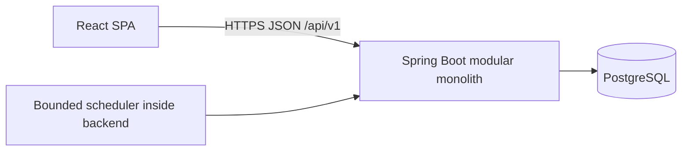

# Steelstory architecture

Status: **APPROVED**, updated 2026-11-12. Foundation is complete; Milestone 2A: Identity is authorized and implemented. Approved requirements and marked business proposals remain distinguished below. The domain module map describes future incremental work; no gameplay modules exist yet.

The application is one Maven backend, a Vite frontend and local PostgreSQL Compose service. `bootstrap.web` contains the public `GET /api/v1/status`, global problem responses and OpenAPI metadata. Explicit Modulith detection finds exactly one module, `identity`, with no allowed domain dependencies; verification remains active. Its named `api` exports only `AccountId` and `AccountAccess.isActive`. Bootstrap security consumes that API and standard Spring authentication interfaces, never identity internals. Flyway V0001 remains unchanged; V0002/V0003 add accounts and JDBC sessions. The frontend retains its small typed status adapter; authentication screens and client generation are deferred. See [README](../README.md), [ADR 0002](adr/0002-tech-stack.md) and [ADR 0003](adr/0003-identity-sessions-and-security.md).

Approved requirements include the retained stack and modular monolith, one-to-many Account -> Character cardinality, five initial attributes (Strength, Dexterity, Intelligence, Constitution and Luck), asynchronous arena attacks without defender acceptance, a planned auction house, OpenAPI contract documentation, and incremental module introduction. Attribute formulas and explicitly marked business proposals remain undecided.

## 1. Shape and priorities

Start with one deployable Spring Boot application, one PostgreSQL database, and a separately built React SPA in a monorepo. Use Spring MVC and blocking JDBC persistence. The dominant correctness problem is concurrent changes to durable game state, not real-time networking.

Favor explicit business operations, small domain objects, database constraints, and short transactions. Keep the design understandable by one developer. Do not add microservices, Kafka, Kubernetes, Redis, event sourcing, a generic workflow engine, or a distributed cache without measured need and an ADR.



Production exposes the SPA and API under the same origin. A web server or hosting ingress can serve static assets and route API traffic. Local development can use Vite's API proxy. No WebSocket service is needed for asynchronous gameplay; ordinary requests and bounded polling are the starting point.

## 2. Modules and allowed dependencies

The following table is the **complete planned allowlist of direct domain-module dependencies**, with the pending wallet-ownership change explicitly marked. A dependency means importing or calling the target's named `api` interface, including consuming its exported event types. Transitive access is not permitted. Unlisted dependencies require a documented architectural change. Introduce modules incrementally, only when an authorized feature requires them; do not scaffold all modules, placeholder APIs or tables at once.

| Module | Owns and exposes | Allowed direct dependencies |
| --- | --- | --- |
| `identity` | Accounts, credentials, account status; account eligibility and identity API | None |
| `catalog` | Immutable, versioned item, enemy, expedition, progression, and loot definitions; definition lookup | None |
| `character` | Many characters per account, character identity/class, level, XP and the five allocated attributes; ownership/eligibility and progression | `identity`, `catalog` |
| `economy` | Wallets, holds, immutable journal and authorized transfers; proposed account gold and character silver | `character`; `identity` conditional on approval of account-owned gold |
| `inventory` | Item instances, ownership, equipment slots, reservations/escrow, delivery storage | `character`, `catalog` |
| `combat` | Pure deterministic combat engine and combat input/output contracts; no live entity lookups | None |
| `loot` | Deterministic reward selection from versioned tables; produces plans, never grants assets | `catalog` |
| `rewards` | Grant receipts and orchestration of XP, items, and currency for a trusted reward plan | `character`, `inventory`, `economy` |
| `expedition` | Expedition lifecycle, deadlines, encounter snapshots, combat records; starts and settles expeditions | `character`, `catalog`, `inventory`, `combat`, `loot`, `rewards` |
| `arena` | Asynchronous attacks, eligibility/cooldowns, ratings, initiation snapshots and records; PvP settlement without defender acceptance | `character`, `catalog`, `inventory`, `combat`, `loot`, `rewards` |
| `guild` | Guilds, membership, roles, invitations, governance | `character` |
| `marketplace` | Planned auction house: listings, deadlines, fees and sale receipts; bids, funded holds and auction closing in later increments | `character`, `inventory`, `economy` |

The graph is acyclic. In particular, `character` does not query inventory for derived combat stats; `expedition` and `arena` assemble character and equipment snapshots and pass values to `combat`. `inventory` owns equip/unequip rules and checks character eligibility through its API. `loot` returns identifiers and quantities; its caller maps these to `rewards` API values, avoiding a reverse dependency.

Guild buffs, treasuries, premium billing, achievements, and notifications are not implicit additions to this graph. Add their concrete use cases and revise dependencies when approved. Combat reports are owned by the initiating gameplay module, not by a globally stateful combat service.

### Account cardinality and proposed currency ownership

**Approved:** Account -> Character is one-to-many: an account may have zero or more characters, and each character has exactly one owning account. Store an account reference on each character without a permanent unique constraint on that reference. An initial character cap is a separate product policy; enforce concurrent creation limits through an account guard exposed by `identity`, with count/creation owned by `character`. Identity does not load character tables or acquire a reverse dependency. No world/shard subsystem is introduced.

**Proposed, requires approval:** premium gold is account-owned; silver is character-owned. `economy` still owns all wallets, holds, journal entries and mutations. Use explicit account-gold and character-silver owner types/keys and database constraints, not an unrestricted owner-type string. Gold references `AccountId` through `identity::api`; silver references `CharacterId` through `character::api`. The conditional direct `economy -> identity` dependency is necessary for account IDs/eligibility, is acyclic, and must not be implemented as approved until the ownership proposal is accepted. Neither identity nor character calls back into economy.

With this proposal, sibling characters share one account gold balance but retain independent silver balances. Adding a character does not create or copy gold; changing the selected character does not change gold ownership. Economy can authorize gold use without a character for account-level purchases. Character-targeted purchases must also verify that the destination character belongs to the authenticated account. A caller-supplied account ID or selected-character session field is never sufficient authority. Audit both the paying account and any acting/receiving character; the owner field remains unambiguous.

Gold debits from different characters serialize on the same account wallet, including requests handled by different backend instances. Gold transaction deduplication is account/business-operation scoped, not per selected character; provider payment identities cannot be replayed through another character. Scope wallet locks by `(owner scope, owner ID, currency)` with a fixed ordering. Character deletion must not delete account gold, and account closure must explicitly settle every character's assets and obligations. Future realms, account services, inter-character silver transfers, gifting and gold trading require explicit policy; none is automatically enabled by one-to-many cardinality or shared gold. The proposal reduces future migration pressure but adds account-level contention and authorization cases.

### Package and enforcement convention

Proposed root: `com.steelstory`. Each business module is a direct subpackage explicitly marked as a Spring Modulith application module. Select explicitly annotated module detection so bootstrap/security wiring is not accidentally a gameplay module.

```text
com.steelstory
  SteelstoryApplication
  bootstrap/                 composition and technical wiring only
  <module>/
    package-info.java        @ApplicationModule and allowedDependencies
    api/                     @NamedInterface("api"); immutable contracts
    internal/
      domain/                pure Java rules and value objects
      application/           use cases, transaction boundaries, required ports
      infrastructure/        JDBC adapters, external adapters
      web/                   HTTP translation
```

Use allowlist entries such as `inventory::api`. Keep module root packages free of accidental public contracts. Do not mark business modules open or disable verification to make a dependency pass. CI will execute `ApplicationModules.of(SteelstoryApplication.class).verify()` and additional architectural rules for pure domains, bootstrap access, and prohibited persistence imports. Spring Modulith provides package and cycle checks, not database access control. [Verification reference](https://docs.spring.io/spring-modulith/reference/verification.html).

Domain code has no HTTP, Spring, JDBC, ORM, or other modules' internal dependencies. Application code coordinates domain behavior and transaction policy. Infrastructure implements narrowly scoped persistence ports. Web code authenticates/decodes requests and maps results; it contains no pricing, eligibility, time, loot, or combat decisions. Avoid interfaces without a real boundary and generic base services/repositories.

Bootstrap wires clocks, authentication, executors, and adapters; it must not become an alternate gameplay orchestration layer. Any small shared technical helper must contain no game entities or rules. Module-owned public ID/value types are preferred to a growing `common` domain.

## 3. Persistence and transaction model

Use Spring JDBC (`JdbcClient`/`JdbcTemplate`) behind module-owned repositories. Explicit SQL makes conditional updates, locking, and escrow behavior visible. This is a deliberate alternative to introducing ORM entity graphs; ordinary domain objects stay persistence-independent.

One database and one transaction manager serve all modules. Table names are prefixed with their owning module. Only that module's adapters may read or write its tables, including reporting queries. Compose read responses through APIs initially. Later read models must have documented ownership and freshness and must never authorize mutations.

References across modules are scalar IDs, not entity associations. Foreign keys to stable owner IDs are allowed where they protect integrity, documented jointly by both modules; they grant no query permission. Avoid cascading deletes across module boundaries. Account/character deletion must explicitly settle assets and pending activity, and is deferred until its policy is defined.

Application service entrypoints own transactions; synchronous participant writes join the same transaction (`REQUIRED`, or `MANDATORY` for explicitly transaction-only internal APIs). Do not use `REQUIRES_NEW` for money, item transfers, or reward receipts. No HTTP calls or other external side effects occur inside these transactions.

Use PostgreSQL `READ COMMITTED` initially with explicit row locking, version checks, conditional updates, and database constraints per invariant. A read-then-write sequence is not a concurrency guarantee. Uniqueness and aggregate limits require constraints or a common guard row, not just row versions. Add serializable isolation only for a demonstrated predicate invariant and test bounded retries.

### Locking and idempotency contract

For workflows touching several modules, acquire locks in this order: HTTP receipt, initiating workflow row, reward/settlement receipt, account guard rows if needed sorted by ID, character guard rows sorted by ID, inventory guard/item rows sorted by ID, wallet rows sorted by owner scope, owner ID and currency. An absent workflow/receipt is established by a unique insert. Claim a reward receipt through its owner API before acquiring account, character or asset locks; grant completion must reuse that claim within the same transaction. Lock all participating characters before any downstream assets, including both sides of a sale or arena snapshot. Account-only gold operations need no invented character lock; the shared wallet lock protects funds. Lower-level APIs must never acquire an earlier lock after a later one; callers prepare required guards first. Define operation-specific lock sets before implementation and test opposite-direction transfers. Global ordering and short transactions reduce deadlocks; bounded whole-transaction retries remain necessary.

Equip, start-expedition, attribute allocation, and snapshot creation share the character guard so snapshots cannot mix old attributes with new equipment. Lock acquisition remains inside owner APIs; workflow code cannot issue SQL against other modules.

For retryable mutations, store a receipt with `(authenticated AccountId, operation, idempotency key)` uniqueness, canonical request hash, status, and stable response reference. Include acting/target character IDs and wallet scope in the request hash where applicable; switching characters does not create a new receipt namespace. Claim and complete it in the same transaction as the mutation. Same key plus same request returns the committed result after rechecking access; different request returns a conflict. Parallel duplicates serialize on uniqueness/locking. A crash before commit leaves no effect; a crash after commit is resolved by replaying the receipt. Keys are scoped to the authenticated actor and bounded in size.

HTTP keys are not enough: enforce unique business effects such as one settlement per listing, one reward grant per expedition, and one premium credit per verified provider transaction. A new HTTP key cannot repeat those effects. Retain durable financial/reward identities; any cleanup of HTTP receipts must preserve business deduplication and define its retry window. Do not promise exactly-once execution; deliver at-least-once attempts with at-most-once committed effects for each business identity.

## 4. Multiplayer risk controls

| Risk | Required control and evidence |
| --- | --- |
| Double spending, overflow, negative balances | Integer amounts (`long`/`BIGINT`), checked arithmetic, explicit maximums, nonnegative player balances, atomic conditional debit/row locks; test concurrent spending and boundary values |
| Multiple characters bypassing shared gold or creation limits | Under the gold proposal, serialize sibling-character gold debits on the account wallet and deduplicate at account scope; serialize character creation against the account cap |
| Currency creation without provenance | Append-only balanced journal per currency, explicit mint/burn system accounts and reasons, atomic cached balances; reconciliation detects drift; correction uses compensating entries |
| Item duplication or stale ownership | One authoritative item record and custody state in inventory; version/lock checks; unique equipment slots and escrow reservation; test equip/sell/transfer races |
| Two buyers, auction-close/bid races, unpaid wins | Listing row serializes bids, purchase, cancellation and close; item escrow and funded currency holds; item/payment/fees/receipt commit together |
| Timers lost on restart or processed twice | Persist deadlines and state, query overdue work, coordinate with database row claims; workers and player-triggered settlement call the same idempotent operation |
| Combat rerolls and changing balance rules | Persist inputs, engine/rules version, hidden seed and RNG algorithm before resolution; deterministic bounded engine and immutable outcome; settle rewards once |
| Concurrent progression and inconsistent combat input | Atomic attribute allocation/XP updates and guarded snapshot capture; pin catalog revisions; test concurrent equip/start and reward/level changes |
| Reward failure when inventory is full | Proposed inventory delivery storage retains grants without deletion or reroll; alternatively fail and retain a retryable entitlement, never partially grant |
| Client cheating and object-level access bypass | Derive actor from server authentication; check resource ownership and eligibility on every use case; never accept client outcomes, balances, prices, or clocks as authority |
| Retry storms, expensive inputs, farming/market abuse | Bound page sizes, payloads, combat turns, work batches and retries; durable cooldowns; auditable asset flows; define economic limits before release |

For silver and gold, expose semantic operations, not a public generic balance setter. Wallet mutations are trusted module APIs, not automatically HTTP endpoints. Premium gold purchases require verified server-side payment evidence and replay protection; a browser payment-success message is insufficient. Payment processing is a future scope requiring refund/chargeback policy before launch.

### Marketplace settlement

**Approved roadmap:** an auction house is planned. Fixed-price listings may be the first increment. Bidding, currency holds and auction closing are later features within `marketplace`, not reasons to prebuild separate modules or infrastructure. Trading currency and detailed policies remain open; silver-only trading is the current proposal.

Listing creation reserves an owned, transferable, unequipped item in inventory escrow in the same transaction as the listing. While escrowed, no other use of that item is possible. A fixed-price purchase locks the listing and participants, validates availability and funds, transfers payment and fees, transfers custody, and completes the listing atomically.

When the later bidding feature is implemented, a bid must reserve actual spendable funds. Replace/release the prior highest bidder's hold atomically; lock all affected wallets in canonical order. Closing consumes the winning hold and transfers the escrow item in one transaction. A bid is valid only while `database time < endsAt`; settlement is valid at or after the deadline. Capture decision time after acquiring the listing lock, rather than using a transaction-start timestamp after a long lock wait. Cancellation, expiry, self-purchase prevention (including sibling-character policy), fees, minimum increments, and anti-sniping are explicit policies to review. The auction house roadmap is approved; its mechanics and delivery schedule are not yet specified.

## 5. Durable time and automated combat

Persist UTC instants in PostgreSQL `timestamptz`; use an injectable `Clock` for pure rule tests. Persist `startedAt`, `endsAt`, state, pinned content versions, and input snapshots. Frontend countdowns are presentation only. Timeliness-sensitive admission uses database time after acquiring the relevant lock; application clocks must be synchronized but cannot override deadlines.

Start with a bounded periodic database poller inside the backend. Index due active work by status/deadline. For short, strictly bounded settlement, select small batches using `FOR UPDATE SKIP LOCKED`, settle in short transactions, and commit. The row lock is the claim; a crash releases it. Never commit a bare `PROCESSING` flag that can strand work. Handle errors per operation, persist retry timing/attempts as needed, and alert on old unresolved work. Late execution after downtime must remain correct.

Do not hold database locks during expensive combat. If measurements show resolution cannot fit a short transaction, introduce persisted leases with an owner token, expiry, and monotonically increasing fencing version. Capture immutable inputs first, compute outside the transaction, then commit only if the token/version still owns the work. Expired workers cannot settle. This is an evolution option, not an initial queue subsystem.

Combat is a pure function of validated fighter snapshots, rules version, and an explicit deterministic random stream. Seed it on the server from secure entropy and persist the seed privately before work can be retried. Pin the PRNG algorithm, draw order, integer/fixed-point rounding, tie-breaking, maximum rounds, and stalemate result. Do not use wall time, unordered collection iteration, current catalog data, or arbitrary floating-point formulas inside resolution. Persist the outcome and audit inputs; retaining seeds alone is insufficient if historical rules disappear.

Expedition/arena modules own results and call `rewards` only for legitimate completed activity. Reward plans are derived server-side, persisted or deterministically reproducible from pinned data, and unavailable as client-controlled grant requests. The grant receipt, journal, item delivery, XP, and initiating settlement state commit together.

**Approved arena behavior:** standard PvP is asynchronous. An authenticated player may initiate an attack against an eligible offline opponent without acceptance or an online-presence check. At match initiation, lock both character guards in canonical order and capture both characters' attributes and equipment consistently through owner APIs in one transaction. Persist both snapshots, rules/content versions, hidden seed and admission/cooldown decisions with the match before resolution; later equipment changes cannot alter it. Authorize ownership of the attacker and attack eligibility of the defender, not ownership of both. Defensive account restrictions and protection rules remain policy questions. Concurrent attacks and replayed initiation must not bypass cooldowns or duplicate the same match; settlement and ratings retain the existing atomicity/idempotency requirements.

## 6. Security and API

Implemented in 2A: Spring Security server-side sessions with Secure (outside local HTTP), HttpOnly, SameSite=Lax cookies and CSRF on registration/login/logout. Spring Session JDBC stores sessions in PostgreSQL without Redis or sticky routing; Flyway owns its schema. An explicit CSRF endpoint returns the token for `X-CSRF-TOKEN`; clients fetch again after login/logout. No CORS permission is added. Restrict CORS if a separate origin is later required; never combine credentialed requests with wildcard origins. [ADR 0003](adr/0003-identity-sessions-and-security.md) defines the boundaries and public-launch blockers.

Use adaptive password hashing through Spring Security, session rotation at login, logout invalidation, and authorization at application entrypoints. Resource IDs are not authorization. Sensitive account-status changes and worker-initiated mutations must follow the same eligibility rules, with explicitly documented exceptions for refund/settlement obligations. Secrets belong in deployment configuration, not source or Vite environment variables exposed to browsers.

Use versioned JSON endpoints, explicit command DTOs and stable problem/error codes. Return conflicts for stale state and idempotency misuse, and distinguish insufficient funds from infrastructure errors without leaking private resources. Encode potentially large currency and XP integers as decimal strings in JSON to avoid JavaScript precision loss. Validate bounds and enums on the backend; TypeScript is not a trust boundary. Avoid logging credentials, session IDs, payment secrets, or hidden RNG seeds.

The SPA organizes features by player capability. It can display estimates and cache read responses, but always reconciles with the server. Disable duplicate clicks for usability while retaining backend idempotency. Keep browser UI state separate from server state; introduce state-management libraries only when their need is concrete.

### OpenAPI contracts

**Required:** document implemented public HTTP endpoints with OpenAPI, including schemas, stable operation IDs, authentication/CSRF requirements, ownership semantics, idempotency headers, conflicts/errors, pagination, UTC times and decimal-string amounts. Internal module APIs are not HTTP contracts and must not be exposed automatically.

**Implemented in Milestone 1:** derive the status contract from Spring MVC adapters/DTOs using springdoc 3.2.0, export the specification during integration tests and compare it structurally with `docs/api/openapi.json`. Review its diff with each API change. Keep annotations out of domain models. ADR 0002 records resolved and executed Boot 4.1 compatibility. Add contracts for later endpoints only with their authorized features.

TypeScript client generation is deferred until it demonstrates a benefit. The current status adapter is typed and runtime-checked. OpenAPI Generator's `typescript-fetch` remains a possible future candidate. If adopted, pin the generator/configuration, keep generated code separate from a small hand-written transport wrapper, and check regeneration drift in CI. The wrapper handles transport concerns as they are introduced; generation is not runtime validation or authorization. Contract dialect and unsupported constructs must be verified with the chosen generator and TypeScript build. Runtime API docs are disabled outside the local/test configuration by default.

## 7. Migrations, testing, and operations

Flyway owns all schema changes, including sessions and any later event-publication tables. Use one ordered migration history, owner-prefixed names, constraints and indexes. Applied migrations are immutable. Disable schema creation by frameworks; there is no production automatic schema update. Use a separate migration role from the runtime role.

CI will run JUnit domain tests, Mockito application tests where useful, Modulith boundary checks, and Testcontainers integration tests against the same PostgreSQL major version as deployment. Concurrency, idempotency, rollback, deadlines, migration upgrades, unauthorized resource access, and deterministic replay require real database/behavior tests. Frontend typechecking, linting, behavior tests and production builds join the pipeline when frontend code exists. See [development guidelines](development-guidelines.md).

Start with structured application logs and Spring Boot health/metrics endpoints restricted to operators. Track transaction errors, lock waits, settlement lag, failed grants, reconciliation discrepancies, and combat duration. Use correlation, operation and receipt IDs. Protect audit data and define retention. Establish database backups and verified restore procedures before production; availability does not replace recovery testing. No separate monitoring cluster is proposed here.

## 8. Evolving to several backend instances

1. **Single deployment:** one backend plus PostgreSQL, static SPA, durable sessions/timers/receipts, and bounded workers. Docker Compose supports local development and a simple single-host deployment if selected. Durable volumes and external backups are required for production.
2. **Measure first:** profile slow queries, indexes, transaction duration, pool saturation, CPU and due-work backlog. Set traffic, latency and recovery targets before sizing. Increase capacity or fix hotspots before adding services.
3. **Add identical instances:** route requests through a load balancer to multiple copies of the same image. Share the database and JDBC sessions. All nodes may poll due work because database claims coordinate them. Use the same rules/content versions, bounded total connection pools, graceful shutdown and health checks. No critical state, lock, timer, cooldown, or deduplication record lives only in JVM memory.
4. **Roll out safely:** run migrations once as a controlled release step before application rollout; the migration lock is a backstop, not orchestration. Use expand/backfill/contract changes so old and new instances can coexist. Gate new rule versions until every possible worker can handle them; retain historical combat resolvers while pending work needs them. Remove columns and old formats only after the prior version is drained. Database rollback generally needs a forward repair, not replaying old binaries against incompatible schema.
5. **Separate resource allocation only if needed:** the same application can run with HTTP or worker roles enabled to reserve CPU for combat without changing domain boundaries. Introduce leases only for measured long computations. Database HA, replicas or service extraction need separate evidence and design; replicas must not authorize spending from stale data.

The database remains the shared consistency and capacity limit. Multiple backend instances improve compute capacity and application availability but do not by themselves provide database or host high availability. Future extraction of economy or inventory would replace local transactions with a designed reservation/settlement protocol and reconciliation; package APIs do not make this free.

## 9. Review questions and proposed defaults

| Topic | Approved boundary and remaining proposal/question |
| --- | --- |
| Initial character limits/worlds | One-to-many cardinality is approved; initial cap, active-character limits and world policy remain open; no world/shard subsystem yet |
| Wallet scope | Proposed account-owned premium gold and character-owned silver require explicit approval before wallet schema/API implementation |
| Marketplace policies | Auction house is planned; fixed-price listings may come first. Silver-only trading is proposed; fees, bid increments, sibling-character trading and anti-sniping remain open |
| Expeditions | One active expedition per character; snapshot at start; no cancellation until refund/reroll policy is agreed |
| PvP effects | Offline attacks without acceptance and snapshots at initiation are approved; protection, cooldowns, sibling-character attacks and rating rules remain open; no theft, item loss or lasting damage unless designed explicitly |
| Inventory overflow | Durable inventory delivery storage for earned rewards and marketplace deliveries; agree capacity/claim rules before implementation |
| Premium purchases | Provider, verification, refunds, chargebacks, promotional gold and transferability unresolved |
| Game balance | Strength, Dexterity, Intelligence, Constitution and Luck are confirmed; formulas, XP curve, loot distributions, item binding and guild limits remain unresolved |
| API tooling | OpenAPI 3.1 export and springdoc 3.2.0 are implemented and tested; TypeScript client generation is deferred until useful |
| Operations | Expected concurrency, action volume, latency/settlement targets, hosting, backup retention and RPO/RTO unresolved |

Authorization currently ends at Milestone 2A Identity; 2B/2C and gameplay require their own scope. Version evidence is centralized in [ADR 0002](adr/0002-tech-stack.md); aggregate rules are in the [domain model](domain-model.md).
