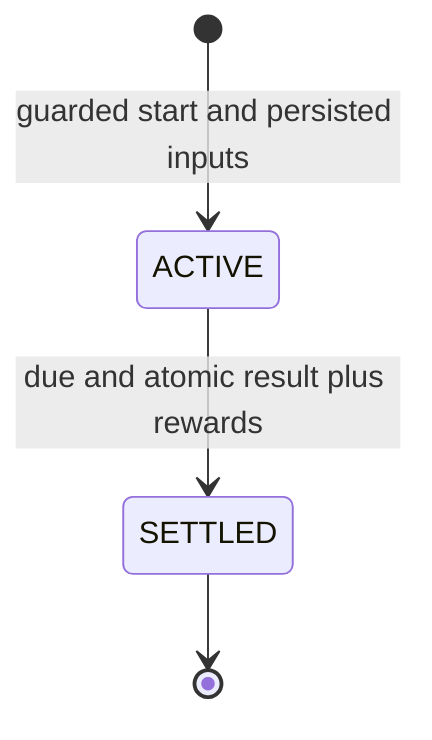

# Steelstory domain model

Status: **Updated after architectural approval with changes**, 2026-11-11. Approved requirements are listed explicitly; aggregate implementation details and marked business proposals remain subject to review. This is not a database schema or approved game balance specification. Module dependencies are defined in [architecture](architecture.md); this document defines ownership and invariants.

## Established game requirements

- Steelstory is an asynchronous multiplayer browser RPG.
- A character permanently chooses Warrior, Archer, or Mage.
- Account -> Character is one-to-many. Each character belongs to one account; an account may have zero or more characters, subject to product limits.
- The five initial player attributes are Strength, Dexterity, Intelligence, Constitution and Luck. Their formulas are undefined.
- Progression includes manually allocated attributes, equipment, timed expeditions, automated combat, loot, PvP arena, guilds and a player marketplace.
- Standard arena PvP is asynchronous: an eligible offline opponent can be attacked without acceptance. Capture consistent combat snapshots at match initiation.
- An auction house is planned. Fixed-price listings may be introduced first; bidding, holds and auction closing are later features.
- Silver is earned through gameplay. Gold is premium currency.
- The planned maximum level is 200.

XP curves, attribute/combat formulas, durations, item slots, trading rules and premium purchase behavior remain design decisions. Account-owned premium gold and character-owned silver are a **proposal requiring approval**, not yet an approved ownership rule. Do not turn examples below into invented balance constants. Introduce these aggregates/modules incrementally with authorized features, not as empty scaffolding.

## Vocabulary and ownership

| Concept / aggregate | Owner | Identity and responsibilities |
| --- | --- | --- |
| Account | `identity` | `AccountId`; credentials, status and authentication eligibility; one-to-many character relationship. Proposed gold owner, while economy owns wallet data/behavior |
| Definition revision | `catalog` | Definition ID plus immutable revision; validated game data and references to compatible rules versions |
| Character | `character` | `CharacterId`, non-unique owning `AccountId` reference; permanent class, XP, level, five named base attributes and unspent points |
| Wallet | `economy` | Pending proposal: account gold keyed by `AccountId`, character silver keyed by `CharacterId`, with explicit owner scope/currency constraints; total, reserved, version and spendable = total minus reserved |
| Journal transaction / entry | `economy` | Immutable operation ID, reason, source and balanced per-currency entries; supports audit and reconciliation |
| Currency hold | `economy` | Unique business reservation ID, wallet, amount, status; reserves spendable funds for an auction or other approved obligation |
| Item instance | `inventory` | Unique `ItemInstanceId`, definition revision, rolled properties, owner and exclusive custody state |
| Inventory guard / equipment | `inventory` | Serializes character inventory mutations, enforces capacity and unique slots; avoids loading the entire collection as one object |
| Delivery entry | `inventory` | Durable entitlement/item custody for grants or purchases awaiting a backpack slot; proposed overflow handling |
| Combat input / result | `combat` | Immutable value contracts; deterministic engine has no persistent aggregate or authority to grant assets |
| Reward plan | `loot` output / caller-owned value | Quantities and definition references selected from a pinned table and deterministic random stream |
| Reward grant | `rewards` | Unique source type + source ID + beneficiary + grant kind; receipt binds one approved plan hash to one committed effect |
| Expedition | `expedition` | ID, character, pinned definition, start/end time, snapshots, seed, lifecycle and settlement/result references |
| Arena match | `arena` | ID, attacker/defender, admission and initiation snapshots/rules, outcome and settlement; no defender acceptance; also owns ratings/cooldowns |
| Guild | `guild` | ID, membership, roles and invitations; no treasury or combat buff behavior is implied |
| Listing / auction | `marketplace` | ID, seller, escrow reference, price/terms, deadlines, state and settlement; planned bidding, holds and closing introduced in later increments |

IDs are opaque and immutable, preferably UUIDs generated without central allocation. Cross-module references use exported API ID types or scalar values. A field containing another module's ID does not confer authority to load its tables. Aggregates need not correspond one-to-one with tables. A single database transaction may update several aggregates through their owner APIs when an invariant spans them.

## Character and progression

A character belongs to exactly one account, and an account may own multiple characters. The model must not enforce permanent uniqueness of the character's account reference. Initial total/active character limits are product policy, not cardinality. If a cap is introduced, concurrent creation must acquire the account guard through `identity::api`, then count/create through character-owned persistence in one transaction. Identity never queries character tables. Character selection is request/UI context; every acting character must be reauthorized against the authenticated account. A single selected-character field does not define account ownership.

Permanent class is set at creation and has no mutation operation. A privileged support interface must not accidentally create a class-change bypass.

XP awards originate from approved gameplay, use checked integer arithmetic, and cannot decrease XP through the normal reward path. Level is consistent with the pinned progression policy and never exceeds 200 under the planned cap. The behavior of surplus XP at the cap is unresolved. Keep the cap in versioned progression policy rather than duplicating it in controllers and frontend code.

Attribute allocation consumes available points atomically; quantities are positive, permitted attributes belong to the applicable rules, and unspent points cannot become negative. Concurrent allocations must not spend the same points twice. Respecs are not implied. Base attributes belong to character; equipment modifiers belong to inventory definitions/instances; combat derives effective stats from an immutable snapshot.

Represent Strength, Dexterity, Intelligence, Constitution and Luck as explicit typed fields in a character attribute value object, with named persistence columns and an explicit attribute identifier for allocation commands where useful. Do not invent their formulas, starting values, limits or class scaling. Future attributes use a deliberate domain/API change, Flyway migration/backfill and rules/snapshot version update. Preserve older combat snapshot interpretation during rollout and replay. This provides extension points without a generic entity-attribute-value (EAV) store, arbitrary attribute maps or a runtime formula language.

## Money and the economy

**Proposed, requires approval:** premium gold belongs to the account and silver belongs to each character. One account gold wallet is shared across all its characters; each character has its own silver wallet. This replaces the original proposal of both currencies per character, but is not yet an approved business rule. Economy owns both wallet implementations. Add a conditional `economy -> identity::api` dependency for account identity/eligibility alongside `economy -> character::api`; no reverse dependency or direct cross-module SQL is needed.

Use explicit owner variants such as account-gold and character-silver, with unique keys and foreign-key/check constraints enforcing the correct owner/currency pair. A surrogate wallet ID may unify journal/hold references without accepting arbitrary owner types. Any system issuance/burn account remains explicitly distinguished from player wallet ownership. Avoid a general polymorphic ownership framework.

Authorize gold spending from the authenticated account and verify ownership of any character receiving the purchase. Authorize silver spending against the acting character. Persist payer scope, owner ID, source operation and any character beneficiary in receipts/journal metadata. Gold debit concurrency is account-wide, so two sibling characters cannot each spend the same remaining gold. HTTP receipts use authenticated account scope with character targets in the request hash; permanent gold/payment effect IDs cannot be reset by character switching. A payment receipt is bound to its verified account, not a browser-supplied character. Existing atomic balance/journal/hold rules apply unchanged.

Creating or deleting a character must neither copy nor destroy account gold. Account closure needs an explicit settlement policy across all characters and obligations. Shared gold can support future account-level purchases without requiring a character; world scope, inter-character silver transfers, gifting and trading remain unresolved and are not granted by this proposal. Multi-character abuse limits and refunds/chargebacks need account-level review. Do not automatically award gold from ordinary gameplay merely because reward APIs can address a wallet.

Amounts are whole units, represented as bounded signed 64-bit integers with explicit positive-amount validation and overflow checks. Silver and gold are distinct currencies with no implicit exchange. Player balances and spendable balances cannot become negative. A hold reduces spendable funds without debiting total balance; capture debits total and releases that reservation once, and release returns funds to spendable once.

Every committed balance change has an immutable journal transaction whose signed entries sum to zero **within each currency**. Gameplay rewards transfer from an explicit system issuance account; fees/burns transfer to explicit system accounts. These system accounts may require different balance constraints from player wallets. Avoid locking one global issuance balance row on every reward: system journal entries can be append-only while player cached balances are updated transactionally. The journal is the audit basis; balances are maintained in the same transaction and reconciled against entries. This is a financial subledger, not event sourcing for the whole game.

No application module writes wallet tables directly. Trusted callers supply operation identity and reason to semantic economy APIs. Ordinary clients cannot choose an issuance reason or call unrestricted credits. Premium payment receipts, refunds and chargebacks require future policy; never silently turn a player wallet negative or delete history to represent a refund.

## Items, equipment and custody

An item definition is reusable content; an item instance is one owned asset with its own rolled properties. Transferring an item changes custody/ownership of that instance, not its identity. Loot grant identity plus ordinal must uniquely identify generated instances so retries cannot mint additional copies.

Proposed exclusive states are `BACKPACK`, `EQUIPPED`, `MARKET_ESCROW`, `DELIVERY`, and `DESTROYED`. An item cannot occupy two states at once. An equipped item has exactly one permitted slot; an escrow item has exactly one reservation/listing reference; a destroyed item cannot be traded or equipped. Constraints should enforce valid state fields and slot uniqueness. Binding/trade eligibility is validated before escrow. Keep seller provenance during escrow; inventory remains authoritative for custody while marketplace owns commercial terms.

Proposed delivery storage handles full backpacks without losing rewards or blocking paid purchases indefinitely. Items in delivery cannot be equipped or listed until claimed through an atomic capacity check. Capacity, expiry (prefer no expiry initially), stacking and storage limits require review. A stackable-item design is deferred until item types need it; it must preserve quantity and reservation invariants.

## Expeditions, combat and rewards

Proposed expedition lifecycle:

Reaching `endsAt` makes an active expedition eligible for settlement; it is a derived condition, not a timer that must fire at an exact instant. Transient failures leave the expedition retryable. No cancellation or cost/refund policy is assumed. Proposed concurrency is one active expedition per character, enforced with a database constraint/guard in addition to API checks.

At start, validate eligibility, capture a consistent character/equipment snapshot and pinned encounter definition, generate hidden seed material and persist deadline/rules version. Whether equipped items remain usable during the expedition is unresolved; a frozen snapshot does not itself reserve the physical items. Start costs, if approved later, must join this transaction and add an explicit economy dependency to the allowlist.

At settlement, either the poller or an authorized player action locks the same expedition, checks authoritative time and lifecycle, resolves deterministic combat and loot, and grants XP/items/currency once. The outcome, reward receipt, all asset changes and `SETTLED` transition share one transaction. If computation later uses leases, it still commits the final effects in this same atomic settlement transaction after fencing validation.

Combat input includes fighter values, effective equipment modifiers, rules version and random stream definition. The engine returns an outcome and bounded report; it cannot read wallets, mutate characters or award loot. Use separate deterministic random streams or explicit derivation for combat and loot so retry behavior and draw ordering are testable. Version these derivations. Preserve historical rules or persist the complete adjudicated result needed for later audit.

The initiating module maps loot output to a trusted reward request. `rewards` checks the grant's unique source and plan hash, calls character/inventory/economy APIs, then records the result. Reusing the grant identity with a different plan is an integrity error. This service is internal orchestration, not a user-facing grant endpoint. Reward authenticity rests on authorized initiating modules; the receipt alone is not proof of entitlement.

## Arena, guilds and marketplace

Arena owns match admission, participant snapshots, rating changes and reward policy. **Approved:** standard arena PvP is asynchronous, allows attacks on eligible offline opponents and requires no defender acceptance. Match initiation validates ownership of the attacker and the defender's attack eligibility; the attacker need not own the defender. Online presence is not a prerequisite.

During initiation, acquire both character guards in stable ID order, then any required inventory locks under the global order. Capture both attribute/equipment snapshots consistently in that transaction and persist them with rules/content versions, hidden seed, match identity and cooldown/admission updates. Attribute allocation and equip operations use the same guards. Resolution uses these immutable initiation snapshots; later changes cannot change the outcome. No waiting-for-acceptance state belongs to standard arena PvP. Replayed initiation and settlement must not duplicate matches, rewards or rating effects. Protection rules, simultaneous-attack limits, sibling-character attacks, theft, persistent injuries, wagered currency and matchmaking remain unresolved.

Guild membership is owned only by guild. Proposed membership is at most one guild per character, enforced with a uniqueness constraint. Role changes and membership acceptance are atomic. Define leadership transfer before permitting leader departure; guild deletion cannot leave invalid memberships. Character holds no second authoritative guild membership field. Guild money, storage and buffs require later design.

**Approved roadmap:** an auction house is planned; fixed-price listings may be delivered first. Marketplace has proposed states `OPEN`, `SOLD`, `EXPIRED`, `CANCELLED`. A terminal state cannot settle again. Fixed-price purchases move escrow item, buyer payment, seller proceeds and fees together. Unsold expiry/cancellation releases escrow exactly once, potentially into delivery storage. Silver-only trading remains a proposal, not an approved currency rule.

Later auction increments add bidding, funded highest-bid holds and auction closing within the existing marketplace/economy boundaries. Admission and closing lock the same listing, preventing a bid after settlement; prior holds are released atomically when outbid. Deterministic tie policy, minimum increments, buyout, fees, deadline extensions, sibling-character bidding and refund behavior must be decided before implementation. Never accept an unfunded bid and hope money remains at closing time. Planned auctions do not require their tables or APIs before that feature is implemented.

## Examples that must become acceptance tests

| Scenario | Required observable outcome |
| --- | --- |
| Two concurrent debits exceed one wallet's funds | At most the affordable debit succeeds; journal and balance agree |
| Two sibling characters concurrently spend proposed account gold | Both requests contend on one account wallet; total spending cannot exceed its spendable balance |
| A gold command/payment is replayed through another character | Account/business identity still deduplicates the effect; mismatched command targets conflict |
| Two character creations race at the product cap | Account guard serializes admission; cardinality still permits multiple characters when the cap allows them |
| Two buyers purchase one listing | One sale commits; losing buyer loses no funds |
| Item is equipped while listing is created | Exactly one valid transition succeeds; no duplicated custody |
| Settlement crashes after commit but before HTTP response | Retry returns the existing result; assets are unchanged |
| Worker and player settle an expedition together | One result and one grant identity commit |
| Attribute allocation races with expedition start | Snapshot corresponds to a single valid guarded state |
| Offline defender is attacked while either participant equips or allocates | No acceptance is required; both persisted initiation snapshots reflect one consistent guarded state |
| Combat retries after a deployment | Pinned inputs, RNG and rules reproduce the stored outcome |
| Database update fails halfway through reward granting | No XP, item, currency, or completed grant receipt is committed |
| Highest bidder is outbid at the closing deadline | Listing lock and database decision time choose one legal transition; no stranded holds |

Open questions and proposed defaults are collected in [architecture section 9](architecture.md#9-review-questions-and-proposed-defaults). Resolve each before implementing the affected feature; documenting a future mechanism does not authorize gameplay implementation now.
